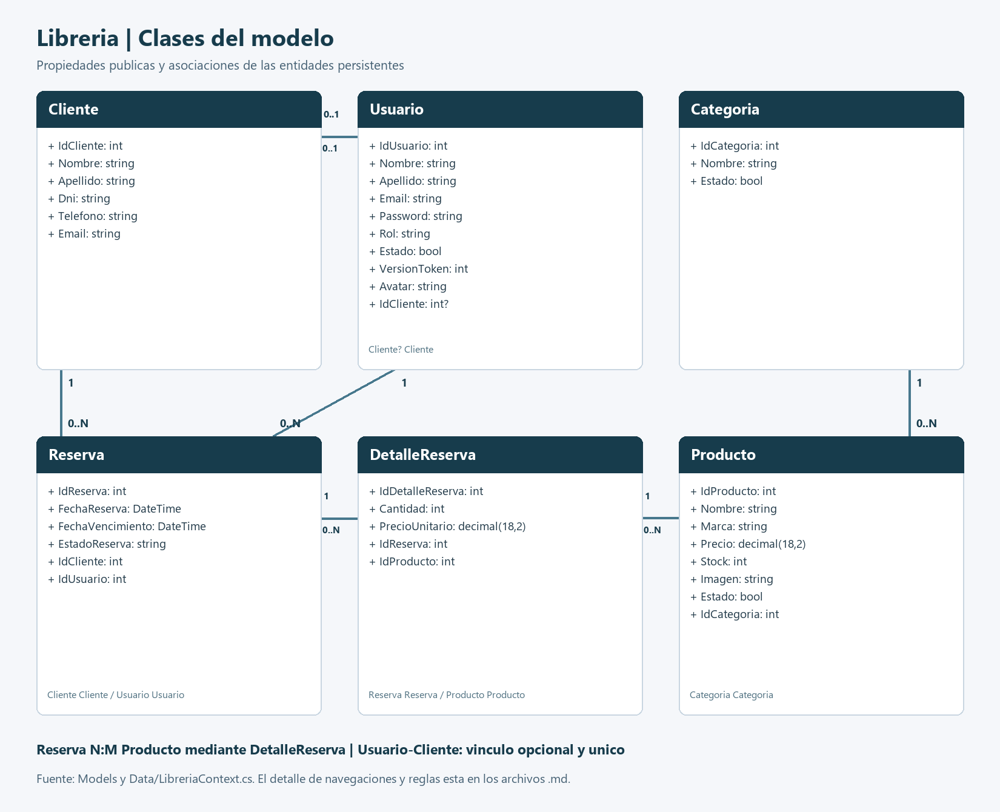
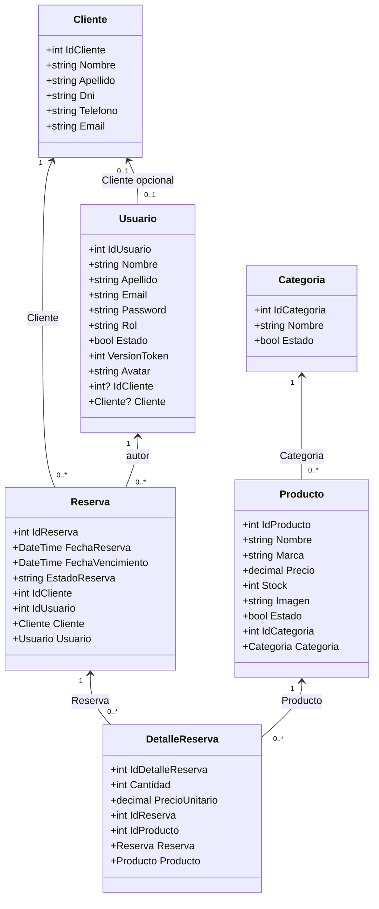

# Diagrama de clases del modelo

Se representan las seis clases persistentes de Models, con sus propiedades y navegaciones. No se inventan colecciones de navegacion que no existen en el codigo. Cliente? en Usuario es opcional; las restantes navegaciones estan configuradas como obligatorias.

LibreriaContext hereda de DbContext y expone los seis DbSet. ReservasService opera sobre Reserva/DetalleReserva/Producto; ImagenesService administra los archivos de Avatar e Imagen. Los controladores coordinan entradas y respuestas, sin ser entidades persistentes.
