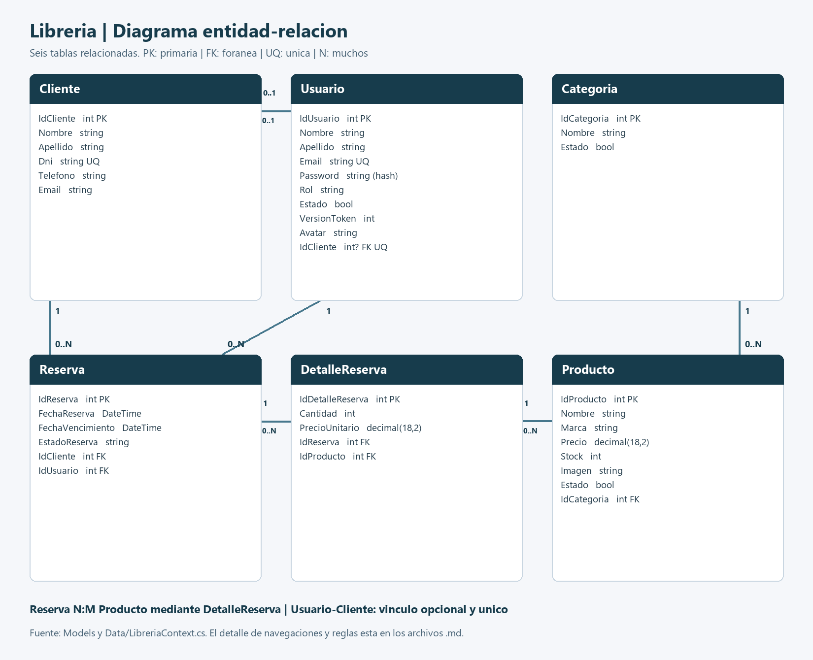
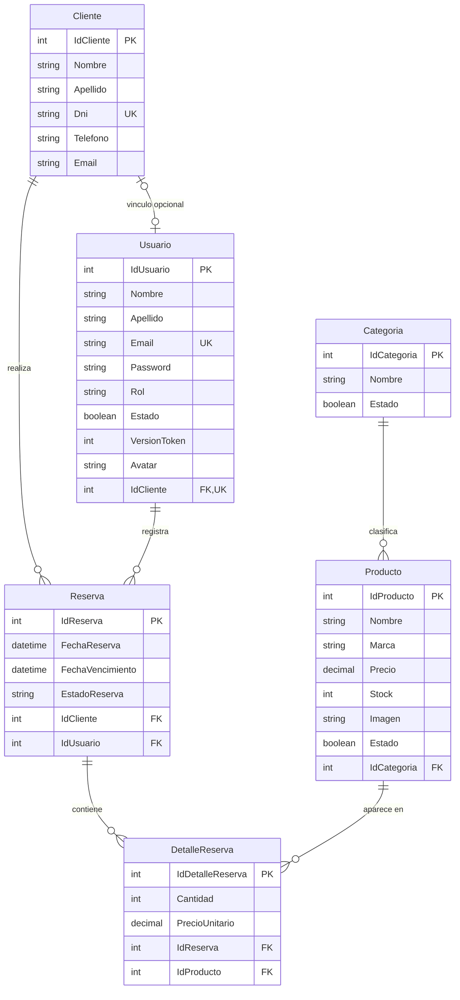

# Diagrama entidad-relacion

PK: clave primaria. FK: clave foranea. UQ/UK: unica. Todas las relaciones se conservan con DeleteBehavior.Restrict.

Usuario.IdCliente puede ser null; un cliente puede tener cero o una cuenta vinculada. Las reservas y productos forman una relacion N:M a traves de DetalleReserva, que agrega cantidad y precio unitario historico.

El dibujo expresa las relaciones que admite la base. En la aplicacion se exige al menos un detalle al crear una reserva; el servicio rechaza productos repetidos en una misma reserva. Esa regla no se representa como restriccion de cardinalidad fisica en MySQL.
