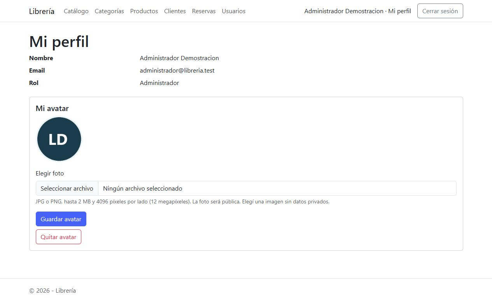
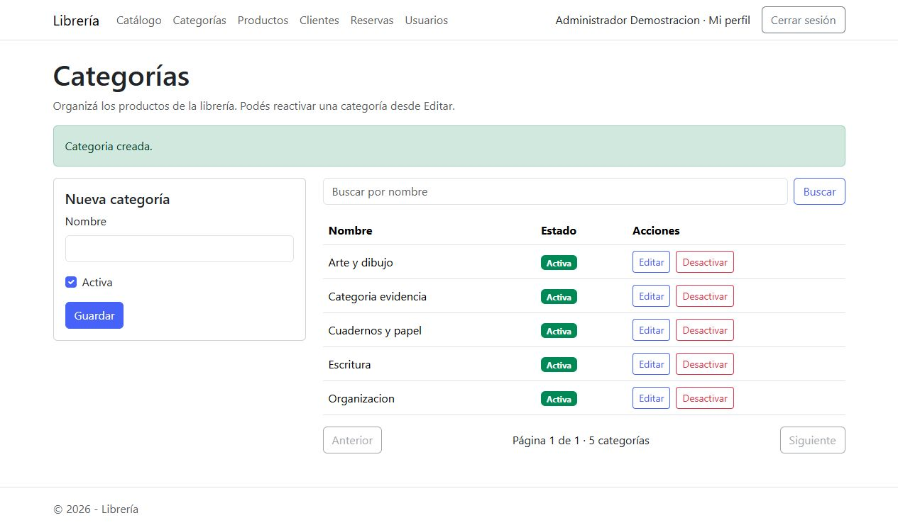

# Evidencias de los requisitos

Capturas reales del navegador tomadas el 05/11/2026 sobre la instalación limpia y datos ficticios del SQL demo. Puerto de revisión: 5100. En la ejecución normal se usa el puerto que indique dotnet run.

| Archivo | Qué muestra |
|---|---|
| [01_Login.png](01_Login.png) | Formulario público de ingreso |
| [02_Perfil_avatar.png](02_Perfil_avatar.png) | Cuenta administrador y avatar de demostración cargado |
| [03_Catalogo_imagen.png](03_Catalogo_imagen.png) | Imagen del producto cargada y visible en el catálogo |
| [04_Productos_pagina2.png](04_Productos_pagina2.png) | Listado de productos en página 2 |
| [05_ABM_antes.png](05_ABM_antes.png) | Formulario con una categoría nueva antes de guardar |
| [06_ABM_alta.png](06_ABM_alta.png) | Mensaje de alta y fila incorporada |
| [07_ABM_edicion.png](07_ABM_edicion.png) | Mensaje de actualización y nombre modificado |
| [08_ABM_baja.png](08_ABM_baja.png) | Baja lógica: fila inactiva e historial conservado |
| [09_Busqueda_clientes.png](09_Busqueda_clientes.png) | Resultados acotados de una búsqueda AJAX de clientes |
| [10_Reserva_cinco_detalles.png](10_Reserva_cinco_detalles.png) | Una cabecera de reserva con cinco líneas |
| [11_Acceso_denegado.png](11_Acceso_denegado.png) | Pantalla de acceso denegado, abierta para mostrar su presentación; el control real de roles se prueba en el informe JSON |
| [Paginado_respuesta.json](Paginado_respuesta.json) | Respuesta real de GET /Productos/Listar?pagina=2 con metadatos y filas |
| [Verificacion_instalacion.json](Verificacion_instalacion.json) | Trece comprobaciones HTTP de la instalación limpia |
| [API_coleccion_resultados.txt](API_coleccion_resultados.txt) | Resultado de las 21 comprobaciones de la colección API |

La prueba de ABM se realizó desde el formulario Vue. Las imágenes de alta/edición/baja muestran las respuestas y la tabla actualizada; el código fetch y sus endpoints se enlazan desde la matriz del README. Las imágenes son capturas, no un montaje de respuestas fabricadas.

Los resultados de la API son un registro HTTP del runner de la colección, no una captura de la interfaz de Postman. La colección queda importable en docs/api y la guía explica Authorization: Bearer. No se guardaron JWT, cookies ni claves en estas evidencias.

